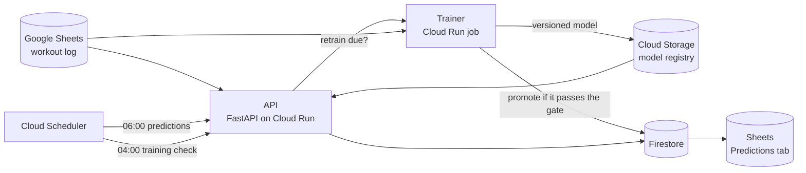

# Workout strength prediction

Predicts the estimated one-rep max (e1RM) of every set in the next workouts, turns it into working weights for
5–10 reps, and keeps its own model up to date. Workouts are logged in Google Sheets; predictions come back to the
same spreadsheet every morning.



## What it does

**Batch inference** (`src/workout_ml/inference`)
- A weekday → workout schedule decides what's next. The batch runs until a workout would repeat an exercise already
  in it: a second prediction for a lift would be missing the first session's result.
- Each workout's template is every exercise and set done on that gym day in the last 30 days.
- Finished workouts score their predictions, which are then frozen. Everything else is overwritten on every run, in
  one atomic commit. A workout done a few days early or late still counts.
- Suspicious input (shrunken sheet, missing columns) or output (non-finite, implausible jumps) aborts the run and
  leaves the previous predictions in place.

**Continuous training** (`src/workout_ml/training`)
- A full sweep (feature selection, tuning, refit) every 30 days.
- An extra retune when the 14-day live error of the *current* model rises above a threshold, limited by a cooldown.
  Three in a row without recovery sends an email.
- A candidate is compared with the live model on the 20 most recent workouts. Both recipes are refit on the data
  before them, and the candidate's search never sees them. Only a pass is promoted.
- Every version is immutable, with its recipe, metrics, data hash and library versions. Rolling back is one request.

All of it is controlled from [`configs/pipeline.yaml`](configs/pipeline.yaml); any value can be overridden with an
environment variable.

## The model

LightGBM, predicting the % change from the last session. It was chosen from 13 candidates (baselines, linear models,
tree ensembles, SARIMA) with walk-forward validation; the study is in [`research/`](research/reports/model_selection.md).

| MAPE | LightGBM | EWMA | Repeat last session |
|---|---|---|---|
| Walk-forward CV | 2.77% | 2.83% | 2.99% |
| Holdout (56 workouts) | 2.71% | 2.70% | 3.03% |

Both clearly beat repeating the last session. LightGBM and a simple moving average (EWMA) are level overall;
LightGBM was better after a break of more than 14 days from a lift (4.1% vs 6.0%, 81 sets), which is a post-hoc
finding on little data. The live-error threshold (3.75%) is about the 95th percentile of the model's historical
14-day error.

## Layout

```
configs/pipeline.yaml    schedule, thresholds, retraining policy
src/workout_ml/
  core/                  features, models, metrics, tuning (no I/O)
  inference/  training/  business logic
  io/                    Sheets, Firestore, Cloud Storage, email, jobs; each with a local stand-in
  api/                   FastAPI
docker/  infra/terraform/  .github/workflows/
tests/                   unit and integration tests on synthetic data
research/                notebooks, model comparison, reports
```

## Run it locally

No cloud account needed; data is synthetic.

```bash
python3.13 -m venv .venv && source .venv/bin/activate
pip install -r requirements/dev.txt && pip install --no-deps -e .
python scripts/make_demo_data.py
docker compose run --rm trainer        # train and promote a first model
docker compose up api                  # http://localhost:8080/docs
pytest
```

## API

| | |
|---|---|
| `POST /v1/predictions/run` | score, predict, publish (`{"dry_run": true}` writes nothing) |
| `GET /v1/predictions/current` · `POST /v1/predictions/sync` | read the batch · rewrite the sheet |
| `GET /v1/schedule/preview` | which workouts and sets would be predicted |
| `POST /v1/training/check` | evaluate the triggers, start a run if due |
| `POST /v1/training/run` · `GET /v1/training/runs` | start now · history |
| `GET /v1/models` · `POST /v1/models/{version}/promote` | versions · promote or roll back |
| `GET /health` · `GET /ready` | liveness · is there a model |

## Deployment

Terraform creates everything with separate least-privilege identities. GitHub Actions tests, builds both images and
deploys them by digest using keyless sign-in, so no service-account keys are stored anywhere. The API is private and
scales to zero; expected cost is within the free tier.

## Known limits

- Errors are one step ahead; nothing is predicted past the point where a lift repeats.
- Scored predictions rely on the sheet being filled in; a set that isn't logged is never scored.
- Pickled models must be loaded with the library versions they were trained with. Both images share pinned
  versions, and a mismatch is logged.
