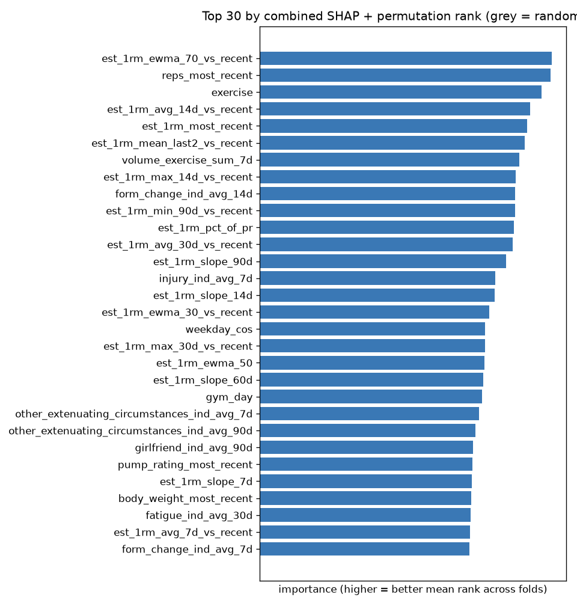
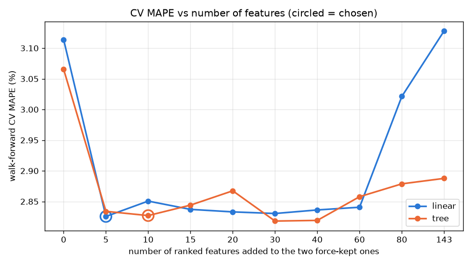

# Feature selection

Run `20261123_205625`, generated 2026-11-23 20:59. Target: **est_1rm** of the next session of each exercise + set. Primary metric: **MAPE** (%); MAE and RMSE are in lb of e1RM.

## Outcome

| stage                            |   features |
|:---------------------------------|-----------:|
| candidates (inference whitelist) |        207 |
| after filter                     |        145 |
| ranked above best random probe   |         43 |
| selected: tree models            |         12 |
| selected: linear models          |          7 |

- **Tree models** (LightGBM, XGBoost, CatBoost, RandomForest) use the top **10** ranked features plus the two force-kept ones (`est_1rm_most_recent`, `est_1rm_ewma_50`): **12** in total.
- **Linear models** (OLS, ElasticNet) use the top **5** plus the same two: **7** in total.
- The best random probe ranked **#44**, so 102 real features scored no better than random noise.

## Data and splits

- Feature table: **4081** set rows. Dropped **75** with no previous session for that exercise + set (nothing to predict from) and **0** with no target.
- **Dev:** 3356 rows, 317 workouts (2025-04-12 to 2026-08-27).
- **Holdout:** 650 rows, 56 workouts (2026-08-29 to 2026-11-22), the last 15% of workout dates. Never used for feature selection or tuning.
- **Walk-forward CV on dev:** 5 expanding-window folds, split by workout date.

|   fold | train_start   | train_end   | val_start   | val_end    |   train_rows |   val_rows |   val_workouts |
|-------:|:--------------|:------------|:------------|:-----------|-------------:|-----------:|---------------:|
|      1 | 2025-04-12    | 2026-01-27  | 2026-01-28  | 2026-03-10 |         1971 |        288 |             26 |
|      2 | 2025-04-12    | 2026-03-10  | 2026-03-11  | 2026-04-14 |         2259 |        277 |             26 |
|      3 | 2025-04-12    | 2026-04-14  | 2026-04-15  | 2026-06-03 |         2536 |        274 |             25 |
|      4 | 2025-04-12    | 2026-06-03  | 2026-06-04  | 2026-07-18 |         2810 |        282 |             25 |
|      5 | 2025-04-12    | 2026-07-18  | 2026-07-19  | 2026-08-27 |         3092 |        264 |             25 |

## Method

1. **Filter** the inference whitelist (`features.get_feature_columns()`): drop features that are more than 50% missing, near-constant (one value in more than 99% of rows), exact duplicates, or in a Spearman |ρ| > 0.95 cluster. Per cluster, keep the feature most correlated with the % change from the last session. The `_vs_recent` features exist because the raw history levels all correlate above this threshold with `est_1rm_most_recent` and would be dropped.
2. **Rank** on each dev fold with a default LightGBM (% target): mean |TreeSHAP| and permutation importance (MAPE increase), both measured on the fold's **validation** block. Rank = average of the two ranks, averaged over folds. 3 random probe columns show where noise lands. Stability = share of folds where the feature is in the top 30.
3. **Size:** CV MAPE for the top-k features with default LightGBM (tree) and default ElasticNet (linear). Each k is compared with the best k on the same workout dates. The chosen k is the smallest whose mean paired difference (`mean_diff`) is within one standard error of it (`se_diff`).

## Stage 1: filter

| reason     |   dropped |
|:-----------|----------:|
| correlated |        49 |
| missing    |         8 |
| duplicate  |         5 |

All 62 dropped features

| feature                                     | reason     | detail                                                      |
|:--------------------------------------------|:-----------|:------------------------------------------------------------|
| est_1rm_avg_3d                              | missing    | 67% missing                                                 |
| est_1rm_max_3d                              | missing    | 67% missing                                                 |
| est_1rm_min_3d                              | missing    | 67% missing                                                 |
| est_1rm_slope_3d                            | missing    | 100% missing                                                |
| est_1rm_std_3d                              | missing    | 100% missing                                                |
| est_1rm_avg_3d_vs_recent                    | missing    | 67% missing                                                 |
| est_1rm_max_3d_vs_recent                    | missing    | 67% missing                                                 |
| est_1rm_min_3d_vs_recent                    | missing    | 67% missing                                                 |
| injury_ind_max_60d                          | duplicate  | identical to injury_ind_max_90d                             |
| vacation_ind_max_60d                        | duplicate  | identical to vacation_ind_max_90d                           |
| form_change_ind_max_60d                     | duplicate  | identical to form_change_ind_max_90d                        |
| other_extenuating_circumstances_ind_max_60d | duplicate  | identical to other_extenuating_circumstances_ind_max_90d    |
| form_change_ind_max_30d                     | duplicate  | identical to form_change_ind_max_90d                        |
| est_1rm_ewma_50_vs_recent                   | correlated | |rho|=0.973 with est_1rm_ewma_70_vs_recent                  |
| est_1rm_mean_last3_vs_recent                | correlated | |rho|=0.957 with est_1rm_ewma_70_vs_recent                  |
| est_1rm_avg_90d_vs_recent                   | correlated | |rho|=0.953 with est_1rm_avg_60d_vs_recent                  |
| est_1rm_ewma_70                             | correlated | |rho|=1.000 with est_1rm_most_recent                        |
| est_1rm_mean_last2                          | correlated | |rho|=0.999 with est_1rm_most_recent                        |
| est_1rm_max_7d                              | correlated | |rho|=0.999 with est_1rm_most_recent                        |
| est_1rm_mean_last3                          | correlated | |rho|=0.998 with est_1rm_most_recent                        |
| est_1rm_ewma_30                             | correlated | |rho|=0.997 with est_1rm_most_recent                        |
| vacation_ind_avg_60d                        | correlated | |rho|=0.972 with vacation_ind_avg_90d                       |
| est_1rm_avg_7d                              | correlated | |rho|=0.999 with est_1rm_most_recent                        |
| vacation_ind_avg_14d                        | correlated | |rho|=0.957 with vacation_ind_max_14d                       |
| est_1rm_min_7d                              | correlated | |rho|=0.999 with est_1rm_most_recent                        |
| est_1rm_max_90d                             | correlated | |rho|=0.991 with est_1rm_most_recent                        |
| est_1rm_min_30d                             | correlated | |rho|=0.995 with est_1rm_most_recent                        |
| est_1rm_max_30d                             | correlated | |rho|=0.995 with est_1rm_most_recent                        |
| est_1rm_avg_30d                             | correlated | |rho|=0.997 with est_1rm_most_recent                        |
| est_1rm_max_60d                             | correlated | |rho|=0.993 with est_1rm_most_recent                        |
| est_1rm_max_14d                             | correlated | |rho|=0.997 with est_1rm_most_recent                        |
| est_1rm_min_60d                             | correlated | |rho|=0.991 with est_1rm_most_recent                        |
| vacation_ind_max_90d                        | correlated | |rho|=0.964 with vacation_ind_max_30d                       |
| est_1rm_pr_to_date                          | correlated | |rho|=0.986 with est_1rm_most_recent                        |
| est_1rm_avg_14d                             | correlated | |rho|=0.998 with est_1rm_most_recent                        |
| est_1rm_avg_60d                             | correlated | |rho|=0.994 with est_1rm_most_recent                        |
| forgot_headphones_ind_avg_90d               | correlated | |rho|=0.992 with forgot_headphones_ind_max_90d              |
| est_1rm_avg_90d                             | correlated | |rho|=0.991 with est_1rm_most_recent                        |
| est_1rm_min_14d                             | correlated | |rho|=0.997 with est_1rm_most_recent                        |
| est_1rm_min_90d                             | correlated | |rho|=0.986 with est_1rm_most_recent                        |
| forgot_headphones_ind_avg_60d               | correlated | |rho|=0.998 with forgot_headphones_ind_max_60d              |
| forgot_headphones_ind_max_30d               | correlated | |rho|=1.000 with forgot_headphones_ind_avg_30d              |
| weight_most_recent                          | correlated | |rho|=0.984 with est_1rm_most_recent                        |
| vacation_ind_max_3d                         | correlated | |rho|=0.993 with vacation_ind_avg_3d                        |
| girlfriend_ind_max_14d                      | correlated | |rho|=0.986 with girlfriend_ind_avg_14d                     |
| vacation_ind_avg_7d                         | correlated | |rho|=0.984 with vacation_ind_max_7d                        |
| illness_ind_max_14d                         | correlated | |rho|=0.998 with illness_ind_avg_14d                        |
| month                                       | correlated | |rho|=0.967 with quarter                                    |
| week_of_year                                | correlated | |rho|=0.962 with quarter                                    |
| day_of_year                                 | correlated | |rho|=0.962 with quarter                                    |
| forgot_headphones_ind_avg_14d               | correlated | |rho|=1.000 with forgot_headphones_ind_max_7d               |
| forgot_headphones_ind_max_14d               | correlated | |rho|=1.000 with forgot_headphones_ind_max_7d               |
| forgot_headphones_ind_avg_7d                | correlated | |rho|=1.000 with forgot_headphones_ind_max_7d               |
| illness_ind_max_7d                          | correlated | |rho|=0.999 with illness_ind_avg_7d                         |
| forgot_headphones_ind_max_3d                | correlated | |rho|=1.000 with forgot_headphones_ind_avg_3d               |
| illness_ind_avg_3d                          | correlated | |rho|=1.000 with illness_ind_max_3d                         |
| illness_ind_max_60d                         | correlated | |rho|=0.965 with illness_ind_avg_60d                        |
| girlfriend_ind_max_7d                       | correlated | |rho|=0.996 with girlfriend_ind_avg_7d                      |
| girlfriend_ind_max_3d                       | correlated | |rho|=0.999 with girlfriend_ind_avg_3d                      |
| illness_ind_avg_30d                         | correlated | |rho|=0.992 with illness_ind_max_30d                        |
| fatigue_ind_avg_3d                          | correlated | |rho|=0.976 with fatigue_ind_max_3d                         |
| other_extenuating_circumstances_ind_avg_3d  | correlated | |rho|=0.965 with other_extenuating_circumstances_ind_max_3d |

## Stage 2: ranking

|   position | feature                                     |   shap_mean |   perm_mean |   mean_rank |   stability | is_probe   | below_probe   |
|-----------:|:--------------------------------------------|------------:|------------:|------------:|------------:|:-----------|:--------------|
|          1 | est_1rm_ewma_70_vs_recent                   |       0.005 |       0.000 |       1.800 |       1.000 | False      | False         |
|          2 | reps_most_recent                            |       0.004 |       0.000 |       2.200 |       1.000 | False      | False         |
|          3 | exercise                                    |       0.006 |       0.000 |       6.600 |       1.000 | False      | False         |
|          4 | est_1rm_avg_14d_vs_recent                   |       0.001 |       0.000 |      12.000 |       1.000 | False      | False         |
|          5 | est_1rm_most_recent                         |       0.000 |       0.767 |      13.600 |       1.000 | False      | False         |
|          6 | est_1rm_mean_last2_vs_recent                |       0.003 |       0.000 |      14.600 |       0.800 | False      | False         |
|          7 | volume_exercise_sum_7d                      |       0.002 |       0.000 |      17.200 |       0.800 | False      | False         |
|          8 | est_1rm_max_14d_vs_recent                   |       0.001 |       0.000 |      19.000 |       0.800 | False      | False         |
|          9 | form_change_ind_avg_14d                     |       0.001 |       0.000 |      19.400 |       0.800 | False      | False         |
|         10 | est_1rm_min_90d_vs_recent                   |       0.001 |       0.000 |      19.400 |       0.800 | False      | False         |
|         11 | est_1rm_pct_of_pr                           |       0.001 |       0.000 |      20.000 |       1.000 | False      | False         |
|         12 | est_1rm_avg_30d_vs_recent                   |       0.001 |       0.000 |      20.600 |       0.800 | False      | False         |
|         13 | est_1rm_slope_90d                           |       0.001 |       0.000 |      23.600 |       0.800 | False      | False         |
|         14 | injury_ind_avg_7d                           |       0.000 |       0.000 |      28.800 |       0.600 | False      | False         |
|         15 | est_1rm_slope_14d                           |       0.002 |       0.000 |      29.200 |       0.600 | False      | False         |
|         16 | est_1rm_ewma_30_vs_recent                   |       0.001 |       0.000 |      31.600 |       0.600 | False      | False         |
|         17 | weekday_cos                                 |       0.000 |       0.000 |      33.600 |       0.600 | False      | False         |
|         18 | est_1rm_max_30d_vs_recent                   |       0.001 |       0.000 |      33.600 |       0.600 | False      | False         |
|         19 | est_1rm_ewma_50                             |       0.000 |      -0.000 |      34.000 |       0.600 | False      | False         |
|         20 | est_1rm_slope_60d                           |       0.001 |      -0.000 |      34.600 |       0.600 | False      | False         |
|         21 | gym_day                                     |       0.000 |       0.000 |      35.200 |       0.600 | False      | False         |
|         22 | other_extenuating_circumstances_ind_avg_7d  |       0.001 |       0.000 |      36.600 |       0.600 | False      | False         |
|         23 | other_extenuating_circumstances_ind_avg_90d |       0.000 |       0.000 |      38.400 |       0.600 | False      | False         |
|         24 | girlfriend_ind_avg_90d                      |       0.001 |       0.000 |      39.400 |       0.200 | False      | False         |
|         25 | pump_rating_most_recent                     |       0.000 |       0.000 |      39.800 |       0.000 | False      | False         |
|         26 | est_1rm_slope_7d                            |       0.000 |       0.000 |      40.200 |       0.200 | False      | False         |
|         27 | body_weight_most_recent                     |       0.000 |       0.000 |      40.400 |       0.400 | False      | False         |
|         28 | fatigue_ind_avg_30d                         |       0.001 |      -0.000 |      40.600 |       0.400 | False      | False         |
|         29 | est_1rm_avg_7d_vs_recent                    |       0.001 |       0.000 |      40.800 |       0.600 | False      | False         |
|         30 | form_change_ind_avg_7d                      |       0.000 |       0.000 |      41.200 |       0.400 | False      | False         |
|         31 | form_change_ind_avg_3d                      |       0.000 |       0.000 |      41.600 |       0.400 | False      | False         |
|         32 | est_1rm_slope_30d                           |       0.001 |       0.000 |      41.800 |       0.400 | False      | False         |
|         33 | days_since_start                            |       0.001 |       0.000 |      42.000 |       0.000 | False      | False         |
|         34 | injury_ind_avg_14d                          |       0.001 |      -0.000 |      45.200 |       0.400 | False      | False         |
|         35 | injury_ind_avg_60d                          |       0.000 |       0.000 |      45.400 |       0.200 | False      | False         |
|         36 | fatigue_ind_avg_90d                         |       0.000 |       0.000 |      48.000 |       0.400 | False      | False         |
|         37 | est_1rm_count_30d                           |       0.000 |      -0.000 |      49.600 |       0.400 | False      | False         |
|         38 | injury_ind_avg_30d                          |       0.000 |       0.000 |      49.600 |       0.200 | False      | False         |
|         39 | est_1rm_std_60d                             |       0.000 |      -0.000 |      49.800 |       0.400 | False      | False         |
|         40 | est_1rm_min_14d_vs_recent                   |       0.000 |       0.000 |      50.200 |       0.200 | False      | False         |

Full ranking (148 rows incl. probes)

|   position | feature                                         |   shap_mean |   perm_mean |   mean_rank |   stability | is_probe   | below_probe   |
|-----------:|:------------------------------------------------|------------:|------------:|------------:|------------:|:-----------|:--------------|
|          1 | est_1rm_ewma_70_vs_recent                       |       0.005 |       0.000 |       1.800 |       1.000 | False      | False         |
|          2 | reps_most_recent                                |       0.004 |       0.000 |       2.200 |       1.000 | False      | False         |
|          3 | exercise                                        |       0.006 |       0.000 |       6.600 |       1.000 | False      | False         |
|          4 | est_1rm_avg_14d_vs_recent                       |       0.001 |       0.000 |      12.000 |       1.000 | False      | False         |
|          5 | est_1rm_most_recent                             |       0.000 |       0.767 |      13.600 |       1.000 | False      | False         |
|          6 | est_1rm_mean_last2_vs_recent                    |       0.003 |       0.000 |      14.600 |       0.800 | False      | False         |
|          7 | volume_exercise_sum_7d                          |       0.002 |       0.000 |      17.200 |       0.800 | False      | False         |
|          8 | est_1rm_max_14d_vs_recent                       |       0.001 |       0.000 |      19.000 |       0.800 | False      | False         |
|          9 | form_change_ind_avg_14d                         |       0.001 |       0.000 |      19.400 |       0.800 | False      | False         |
|         10 | est_1rm_min_90d_vs_recent                       |       0.001 |       0.000 |      19.400 |       0.800 | False      | False         |
|         11 | est_1rm_pct_of_pr                               |       0.001 |       0.000 |      20.000 |       1.000 | False      | False         |
|         12 | est_1rm_avg_30d_vs_recent                       |       0.001 |       0.000 |      20.600 |       0.800 | False      | False         |
|         13 | est_1rm_slope_90d                               |       0.001 |       0.000 |      23.600 |       0.800 | False      | False         |
|         14 | injury_ind_avg_7d                               |       0.000 |       0.000 |      28.800 |       0.600 | False      | False         |
|         15 | est_1rm_slope_14d                               |       0.002 |       0.000 |      29.200 |       0.600 | False      | False         |
|         16 | est_1rm_ewma_30_vs_recent                       |       0.001 |       0.000 |      31.600 |       0.600 | False      | False         |
|         17 | weekday_cos                                     |       0.000 |       0.000 |      33.600 |       0.600 | False      | False         |
|         18 | est_1rm_max_30d_vs_recent                       |       0.001 |       0.000 |      33.600 |       0.600 | False      | False         |
|         19 | est_1rm_ewma_50                                 |       0.000 |      -0.000 |      34.000 |       0.600 | False      | False         |
|         20 | est_1rm_slope_60d                               |       0.001 |      -0.000 |      34.600 |       0.600 | False      | False         |
|         21 | gym_day                                         |       0.000 |       0.000 |      35.200 |       0.600 | False      | False         |
|         22 | other_extenuating_circumstances_ind_avg_7d      |       0.001 |       0.000 |      36.600 |       0.600 | False      | False         |
|         23 | other_extenuating_circumstances_ind_avg_90d     |       0.000 |       0.000 |      38.400 |       0.600 | False      | False         |
|         24 | girlfriend_ind_avg_90d                          |       0.001 |       0.000 |      39.400 |       0.200 | False      | False         |
|         25 | pump_rating_most_recent                         |       0.000 |       0.000 |      39.800 |       0.000 | False      | False         |
|         26 | est_1rm_slope_7d                                |       0.000 |       0.000 |      40.200 |       0.200 | False      | False         |
|         27 | body_weight_most_recent                         |       0.000 |       0.000 |      40.400 |       0.400 | False      | False         |
|         28 | fatigue_ind_avg_30d                             |       0.001 |      -0.000 |      40.600 |       0.400 | False      | False         |
|         29 | est_1rm_avg_7d_vs_recent                        |       0.001 |       0.000 |      40.800 |       0.600 | False      | False         |
|         30 | form_change_ind_avg_7d                          |       0.000 |       0.000 |      41.200 |       0.400 | False      | False         |
|         31 | form_change_ind_avg_3d                          |       0.000 |       0.000 |      41.600 |       0.400 | False      | False         |
|         32 | est_1rm_slope_30d                               |       0.001 |       0.000 |      41.800 |       0.400 | False      | False         |
|         33 | days_since_start                                |       0.001 |       0.000 |      42.000 |       0.000 | False      | False         |
|         34 | injury_ind_avg_14d                              |       0.001 |      -0.000 |      45.200 |       0.400 | False      | False         |
|         35 | injury_ind_avg_60d                              |       0.000 |       0.000 |      45.400 |       0.200 | False      | False         |
|         36 | fatigue_ind_avg_90d                             |       0.000 |       0.000 |      48.000 |       0.400 | False      | False         |
|         37 | est_1rm_count_30d                               |       0.000 |      -0.000 |      49.600 |       0.400 | False      | False         |
|         38 | injury_ind_avg_30d                              |       0.000 |       0.000 |      49.600 |       0.200 | False      | False         |
|         39 | est_1rm_std_60d                                 |       0.000 |      -0.000 |      49.800 |       0.400 | False      | False         |
|         40 | est_1rm_min_14d_vs_recent                       |       0.000 |       0.000 |      50.200 |       0.200 | False      | False         |
|         41 | est_1rm_std_90d                                 |       0.001 |      -0.000 |      50.400 |       0.400 | False      | False         |
|         42 | days_since_last_exercise_set                    |       0.001 |      -0.000 |      51.000 |       0.400 | False      | False         |
|         43 | girlfriend_ind_avg_60d                          |       0.000 |       0.000 |      52.000 |       0.200 | False      | False         |
|         44 | _probe_1                                        |       0.001 |      -0.000 |      52.600 |       0.200 | True       | False         |
|         45 | form_change_ind_avg_60d                         |       0.000 |      -0.000 |      54.000 |       0.200 | False      | True          |
|         46 | days_since_last_same_gym_day                    |       0.000 |       0.000 |      54.400 |       0.400 | False      | True          |
|         47 | est_1rm_max_90d_vs_recent                       |       0.000 |      -0.000 |      54.800 |       0.200 | False      | True          |
|         48 | est_1rm_avg_60d_vs_recent                       |       0.001 |      -0.000 |      55.200 |       0.200 | False      | True          |
|         49 | est_1rm_count_90d                               |       0.000 |      -0.000 |      55.800 |       0.400 | False      | True          |
|         50 | _probe_0                                        |       0.000 |      -0.000 |      56.000 |       0.200 | True       | False         |
|         51 | exercise_order                                  |       0.000 |       0.000 |      56.000 |       0.400 | False      | True          |
|         52 | body_weight_slope_14d                           |       0.000 |      -0.000 |      56.200 |       0.200 | False      | True          |
|         53 | form_change_ind_avg_90d                         |       0.000 |       0.000 |      56.800 |       0.000 | False      | True          |
|         54 | est_1rm_count_60d                               |       0.000 |      -0.000 |      56.800 |       0.200 | False      | True          |
|         55 | form_change_ind_avg_30d                         |       0.001 |      -0.000 |      58.000 |       0.000 | False      | True          |
|         56 | est_1rm_min_60d_vs_recent                       |       0.001 |      -0.000 |      58.200 |       0.200 | False      | True          |
|         57 | injury_ind_avg_3d                               |       0.000 |       0.000 |      58.600 |       0.000 | False      | True          |
|         58 | volume_exercise_sum_14d                         |       0.000 |       0.000 |      59.200 |       0.400 | False      | True          |
|         59 | est_1rm_std_14d                                 |       0.000 |      -0.000 |      59.600 |       0.400 | False      | True          |
|         60 | volume_gym_day_sum_14d                          |       0.000 |      -0.000 |      62.200 |       0.400 | False      | True          |
|         61 | workout_rating_most_recent                      |       0.001 |      -0.000 |      62.200 |       0.200 | False      | True          |
|         62 | illness_ind_avg_14d                             |       0.000 |       0.000 |      63.400 |       0.000 | False      | True          |
|         63 | weekday_sin                                     |       0.000 |       0.000 |      63.800 |       0.000 | False      | True          |
|         64 | week_of_year_cos                                |       0.000 |      -0.000 |      63.800 |       0.000 | False      | True          |
|         65 | body_weight_avg_30d                             |       0.000 |      -0.000 |      64.600 |       0.000 | False      | True          |
|         66 | est_1rm_std_30d                                 |       0.000 |      -0.000 |      65.000 |       0.200 | False      | True          |
|         67 | week_of_year_sin                                |       0.000 |       0.000 |      65.400 |       0.200 | False      | True          |
|         68 | other_extenuating_circumstances_ind_avg_60d     |       0.000 |      -0.000 |      65.400 |       0.200 | False      | True          |
|         69 | fatigue_ind_avg_60d                             |       0.000 |      -0.000 |      65.800 |       0.000 | False      | True          |
|         70 | fatigue_ind_max_3d                              |       0.000 |       0.000 |      67.200 |       0.000 | False      | True          |
|         71 | other_extenuating_circumstances_ind_most_recent |       0.000 |       0.000 |      69.600 |       0.000 | False      | True          |
|         72 | month_sin                                       |       0.000 |       0.000 |      70.000 |       0.000 | False      | True          |
|         73 | est_1rm_max_60d_vs_recent                       |       0.000 |      -0.000 |      70.200 |       0.000 | False      | True          |
|         74 | weekday                                         |       0.000 |       0.000 |      70.400 |       0.400 | False      | True          |
|         75 | volume_gym_day_sum_7d                           |       0.000 |      -0.000 |      71.200 |       0.200 | False      | True          |
|         76 | injury_ind_avg_90d                              |       0.000 |      -0.000 |      71.800 |       0.000 | False      | True          |
|         77 | other_extenuating_circumstances_ind_avg_14d     |       0.000 |       0.000 |      72.000 |       0.200 | False      | True          |
|         78 | vacation_ind_avg_30d                            |       0.001 |      -0.000 |      72.600 |       0.200 | False      | True          |
|         79 | fatigue_ind_avg_7d                              |       0.000 |      -0.000 |      73.400 |       0.000 | False      | True          |
|         80 | other_extenuating_circumstances_ind_avg_30d     |       0.000 |      -0.000 |      74.400 |       0.000 | False      | True          |
|         81 | body_weight_avg_14d                             |       0.000 |      -0.000 |      75.000 |       0.000 | False      | True          |
|         82 | est_1rm_max_7d_vs_recent                        |       0.000 |       0.000 |      75.200 |       0.000 | False      | True          |
|         83 | vacation_ind_avg_90d                            |       0.000 |      -0.000 |      75.400 |       0.000 | False      | True          |
|         84 | est_1rm_min_30d_vs_recent                       |       0.000 |      -0.000 |      80.800 |       0.000 | False      | True          |
|         85 | est_1rm_min_7d_vs_recent                        |       0.000 |       0.000 |      81.400 |       0.200 | False      | True          |
|         86 | body_weight_slope_30d                           |       0.000 |      -0.000 |      82.800 |       0.000 | False      | True          |
|         87 | vacation_ind_most_recent                        |       0.000 |       0.000 |      83.200 |       0.000 | False      | True          |
|         88 | days_since_last_workout                         |       0.000 |       0.000 |      84.600 |       0.000 | False      | True          |
|         89 | month_cos                                       |       0.000 |      -0.000 |      84.800 |       0.000 | False      | True          |
|         90 | quarter                                         |       0.000 |       0.000 |      87.000 |       0.000 | False      | True          |
|         91 | girlfriend_ind_avg_30d                          |       0.000 |      -0.000 |      88.800 |       0.000 | False      | True          |
|         92 | illness_ind_avg_7d                              |       0.000 |       0.000 |      90.600 |       0.000 | False      | True          |
|         93 | injury_ind_max_7d                               |       0.000 |       0.000 |      91.600 |       0.000 | False      | True          |
|         94 | est_1rm_std_7d                                  |       0.000 |      -0.000 |      92.600 |       0.000 | False      | True          |
|         95 | form_change_ind_most_recent                     |       0.000 |       0.000 |      93.200 |       0.200 | False      | True          |
|         96 | vacation_ind_max_14d                            |       0.000 |       0.000 |      93.800 |       0.000 | False      | True          |
|         97 | _probe_2                                        |       0.000 |      -0.000 |      94.200 |       0.000 | True       | False         |
|         98 | set_number                                      |       0.000 |      -0.000 |      94.400 |       0.000 | False      | True          |
|         99 | girlfriend_ind_avg_3d                           |       0.000 |      -0.000 |      96.800 |       0.000 | False      | True          |
|        100 | illness_ind_avg_60d                             |       0.000 |      -0.000 |      97.000 |       0.000 | False      | True          |
|        101 | other_extenuating_circumstances_ind_max_7d      |       0.000 |      -0.000 |      97.200 |       0.000 | False      | True          |
|        102 | injury_ind_most_recent                          |       0.000 |      -0.000 |      97.200 |       0.000 | False      | True          |
|        103 | fatigue_ind_avg_14d                             |       0.000 |      -0.000 |      97.400 |       0.000 | False      | True          |
|        104 | est_1rm_count_14d                               |       0.000 |      -0.000 |      99.800 |       0.000 | False      | True          |
|        105 | form_change_ind_max_14d                         |       0.000 |       0.000 |     101.200 |       0.000 | False      | True          |
|        106 | form_change_ind_max_3d                          |       0.000 |      -0.000 |     102.400 |       0.000 | False      | True          |
|        107 | est_1rm_count_7d                                |       0.000 |      -0.000 |     105.200 |       0.000 | False      | True          |
|        108 | girlfriend_ind_max_90d                          |       0.000 |       0.000 |     107.000 |       0.000 | False      | True          |
|        109 | illness_ind_most_recent                         |       0.000 |       0.000 |     107.600 |       0.000 | False      | True          |
|        110 | est_1rm_count_3d                                |       0.000 |       0.000 |     107.600 |       0.000 | False      | True          |
|        111 | vacation_ind_max_7d                             |       0.000 |      -0.000 |     108.200 |       0.000 | False      | True          |
|        112 | fatigue_ind_max_90d                             |       0.000 |       0.000 |     108.800 |       0.000 | False      | True          |
|        113 | girlfriend_ind_most_recent                      |       0.000 |       0.000 |     108.800 |       0.000 | False      | True          |
|        114 | rpe_most_recent                                 |       0.000 |       0.000 |     109.000 |       0.000 | False      | True          |
|        115 | other_extenuating_circumstances_ind_max_14d     |       0.000 |      -0.000 |     109.400 |       0.000 | False      | True          |
|        116 | other_extenuating_circumstances_ind_max_3d      |       0.000 |      -0.000 |     109.600 |       0.000 | False      | True          |
|        117 | forgot_headphones_ind_avg_30d                   |       0.000 |       0.000 |     109.800 |       0.000 | False      | True          |
|        118 | fatigue_ind_most_recent                         |       0.000 |      -0.000 |     111.800 |       0.000 | False      | True          |
|        119 | is_weekend                                      |       0.000 |      -0.000 |     112.800 |       0.000 | False      | True          |
|        120 | girlfriend_ind_avg_7d                           |       0.000 |      -0.000 |     113.400 |       0.000 | False      | True          |
|        121 | forgot_headphones_ind_most_recent               |       0.000 |       0.000 |     113.600 |       0.000 | False      | True          |
|        122 | illness_ind_max_3d                              |       0.000 |      -0.000 |     113.600 |       0.000 | False      | True          |
|        123 | form_change_ind_max_90d                         |       0.000 |       0.000 |     114.400 |       0.000 | False      | True          |
|        124 | other_extenuating_circumstances_ind_max_30d     |       0.000 |       0.000 |     114.600 |       0.000 | False      | True          |
|        125 | illness_ind_avg_90d                             |       0.000 |      -0.000 |     114.600 |       0.000 | False      | True          |
|        126 | girlfriend_ind_avg_14d                          |       0.000 |      -0.000 |     115.200 |       0.000 | False      | True          |
|        127 | injury_ind_max_90d                              |       0.000 |       0.000 |     115.600 |       0.000 | False      | True          |
|        128 | forgot_headphones_ind_max_7d                    |       0.000 |       0.000 |     116.200 |       0.000 | False      | True          |
|        129 | other_extenuating_circumstances_ind_max_90d     |       0.000 |       0.000 |     116.400 |       0.000 | False      | True          |
|        130 | illness_ind_max_90d                             |       0.000 |       0.000 |     116.600 |       0.000 | False      | True          |
|        131 | type                                            |       0.000 |      -0.000 |     116.800 |       0.000 | False      | True          |
|        132 | fatigue_ind_max_14d                             |       0.000 |      -0.000 |     117.600 |       0.000 | False      | True          |
|        133 | fatigue_ind_max_60d                             |       0.000 |       0.000 |     118.600 |       0.000 | False      | True          |
|        134 | form_change_ind_max_7d                          |       0.000 |       0.000 |     119.400 |       0.000 | False      | True          |
|        135 | forgot_headphones_ind_max_90d                   |       0.000 |       0.000 |     119.600 |       0.000 | False      | True          |
|        136 | fatigue_ind_max_30d                             |       0.000 |       0.000 |     121.600 |       0.000 | False      | True          |
|        137 | girlfriend_ind_max_60d                          |       0.000 |       0.000 |     121.800 |       0.000 | False      | True          |
|        138 | forgot_headphones_ind_max_60d                   |       0.000 |       0.000 |     123.600 |       0.000 | False      | True          |
|        139 | injury_ind_max_3d                               |       0.000 |       0.000 |     123.800 |       0.000 | False      | True          |
|        140 | vacation_ind_avg_3d                             |       0.000 |      -0.000 |     124.800 |       0.000 | False      | True          |
|        141 | injury_ind_max_30d                              |       0.000 |       0.000 |     125.400 |       0.000 | False      | True          |
|        142 | illness_ind_max_30d                             |       0.000 |       0.000 |     126.400 |       0.000 | False      | True          |
|        143 | fatigue_ind_max_7d                              |       0.000 |       0.000 |     127.400 |       0.000 | False      | True          |
|        144 | vacation_ind_max_30d                            |       0.000 |       0.000 |     129.000 |       0.000 | False      | True          |
|        145 | girlfriend_ind_max_30d                          |       0.000 |      -0.000 |     131.000 |       0.000 | False      | True          |
|        146 | injury_ind_max_14d                              |       0.000 |       0.000 |     131.200 |       0.000 | False      | True          |
|        147 | forgot_headphones_ind_avg_3d                    |       0.000 |       0.000 |     137.800 |       0.000 | False      | True          |
|        148 | is_return_from_break                            |       0.000 |      -0.000 |     140.800 |       0.000 | False      | True          |

102 features ranked at or below the best random probe

`form_change_ind_avg_60d`, `days_since_last_same_gym_day`, `est_1rm_max_90d_vs_recent`, `est_1rm_avg_60d_vs_recent`, `est_1rm_count_90d`, `exercise_order`, `body_weight_slope_14d`, `form_change_ind_avg_90d`, `est_1rm_count_60d`, `form_change_ind_avg_30d`, `est_1rm_min_60d_vs_recent`, `injury_ind_avg_3d`, `volume_exercise_sum_14d`, `est_1rm_std_14d`, `volume_gym_day_sum_14d`, `workout_rating_most_recent`, `illness_ind_avg_14d`, `weekday_sin`, `week_of_year_cos`, `body_weight_avg_30d`, `est_1rm_std_30d`, `week_of_year_sin`, `other_extenuating_circumstances_ind_avg_60d`, `fatigue_ind_avg_60d`, `fatigue_ind_max_3d`, `other_extenuating_circumstances_ind_most_recent`, `month_sin`, `est_1rm_max_60d_vs_recent`, `weekday`, `volume_gym_day_sum_7d`, `injury_ind_avg_90d`, `other_extenuating_circumstances_ind_avg_14d`, `vacation_ind_avg_30d`, `fatigue_ind_avg_7d`, `other_extenuating_circumstances_ind_avg_30d`, `body_weight_avg_14d`, `est_1rm_max_7d_vs_recent`, `vacation_ind_avg_90d`, `est_1rm_min_30d_vs_recent`, `est_1rm_min_7d_vs_recent`, `body_weight_slope_30d`, `vacation_ind_most_recent`, `days_since_last_workout`, `month_cos`, `quarter`, `girlfriend_ind_avg_30d`, `illness_ind_avg_7d`, `injury_ind_max_7d`, `est_1rm_std_7d`, `form_change_ind_most_recent`, `vacation_ind_max_14d`, `set_number`, `girlfriend_ind_avg_3d`, `illness_ind_avg_60d`, `other_extenuating_circumstances_ind_max_7d`, `injury_ind_most_recent`, `fatigue_ind_avg_14d`, `est_1rm_count_14d`, `form_change_ind_max_14d`, `form_change_ind_max_3d`, `est_1rm_count_7d`, `girlfriend_ind_max_90d`, `illness_ind_most_recent`, `est_1rm_count_3d`, `vacation_ind_max_7d`, `fatigue_ind_max_90d`, `girlfriend_ind_most_recent`, `rpe_most_recent`, `other_extenuating_circumstances_ind_max_14d`, `other_extenuating_circumstances_ind_max_3d`, `forgot_headphones_ind_avg_30d`, `fatigue_ind_most_recent`, `is_weekend`, `girlfriend_ind_avg_7d`, `forgot_headphones_ind_most_recent`, `illness_ind_max_3d`, `form_change_ind_max_90d`, `other_extenuating_circumstances_ind_max_30d`, `illness_ind_avg_90d`, `girlfriend_ind_avg_14d`, `injury_ind_max_90d`, `forgot_headphones_ind_max_7d`, `other_extenuating_circumstances_ind_max_90d`, `illness_ind_max_90d`, `type`, `fatigue_ind_max_14d`, `fatigue_ind_max_60d`, `form_change_ind_max_7d`, `forgot_headphones_ind_max_90d`, `fatigue_ind_max_30d`, `girlfriend_ind_max_60d`, `forgot_headphones_ind_max_60d`, `injury_ind_max_3d`, `vacation_ind_avg_3d`, `injury_ind_max_30d`, `illness_ind_max_30d`, `fatigue_ind_max_7d`, `vacation_ind_max_30d`, `girlfriend_ind_max_30d`, `injury_ind_max_14d`, `forgot_headphones_ind_avg_3d`, `is_return_from_break`

## Stage 3: how many features

| family   |   k |   n_features |   cv_mape |   cv_mae |   cv_rmse |   mean_diff |   se_diff | ok    |
|:---------|----:|-------------:|----------:|---------:|----------:|------------:|----------:|:------|
| tree     |   0 |            2 |     3.065 |    7.229 |    10.519 |       0.252 |     0.064 | False |
| tree     |   5 |            7 |     2.834 |    6.789 |     9.719 |       0.041 |     0.038 | False |
| tree     |  10 |           12 |     2.827 |    6.707 |     9.515 |       0.022 |     0.032 | True  |
| tree     |  15 |           17 |     2.844 |    6.737 |     9.554 |       0.025 |     0.022 | False |
| tree     |  20 |           22 |     2.867 |    6.777 |     9.642 |       0.052 |     0.025 | False |
| tree     |  30 |           32 |     2.818 |    6.689 |     9.630 |       0.006 |     0.018 | True  |
| tree     |  40 |           42 |     2.819 |    6.701 |     9.616 |       0.000 |     0.000 | True  |
| tree     |  60 |           62 |     2.858 |    6.768 |     9.662 |       0.048 |     0.020 | False |
| tree     |  80 |           82 |     2.879 |    6.802 |     9.700 |       0.060 |     0.022 | False |
| tree     | 143 |          145 |     2.888 |    6.823 |     9.718 |       0.064 |     0.024 | False |
| linear   |   0 |            2 |     3.114 |    7.352 |    10.830 |       0.284 |     0.049 | False |
| linear   |   5 |            7 |     2.826 |    6.759 |     9.721 |       0.000 |     0.000 | True  |
| linear   |  10 |           12 |     2.851 |    6.803 |     9.811 |       0.024 |     0.021 | False |
| linear   |  15 |           17 |     2.837 |    6.771 |     9.743 |       0.011 |     0.020 | True  |
| linear   |  20 |           22 |     2.833 |    6.757 |     9.731 |       0.007 |     0.022 | True  |
| linear   |  30 |           32 |     2.830 |    6.730 |     9.709 |       0.001 |     0.025 | True  |
| linear   |  40 |           42 |     2.836 |    6.746 |     9.703 |       0.008 |     0.025 | True  |
| linear   |  60 |           62 |     2.841 |    6.747 |     9.659 |       0.015 |     0.028 | True  |
| linear   |  80 |           82 |     3.021 |    7.132 |    10.123 |       0.189 |     0.066 | False |
| linear   | 143 |          145 |     3.128 |    7.396 |    10.429 |       0.293 |     0.080 | False |

## Selected features

**Tree models (12):** `est_1rm_most_recent`, `est_1rm_ewma_50`, `est_1rm_ewma_70_vs_recent`, `reps_most_recent`, `exercise`, `est_1rm_avg_14d_vs_recent`, `est_1rm_mean_last2_vs_recent`, `volume_exercise_sum_7d`, `est_1rm_max_14d_vs_recent`, `form_change_ind_avg_14d`, `est_1rm_min_90d_vs_recent`, `est_1rm_pct_of_pr`

**Linear models (7):** `est_1rm_most_recent`, `est_1rm_ewma_50`, `est_1rm_ewma_70_vs_recent`, `reps_most_recent`, `exercise`, `est_1rm_avg_14d_vs_recent`, `est_1rm_mean_last2_vs_recent`

## Caveats

- Selection and tuning share the dev folds, so dev-CV scores are slightly optimistic. The holdout in `model_selection.md` is the unbiased comparison.
- Correlation clustering keeps one representative per cluster. A dropped feature can be as useful as the one kept; the drop table shows which feature replaced it.