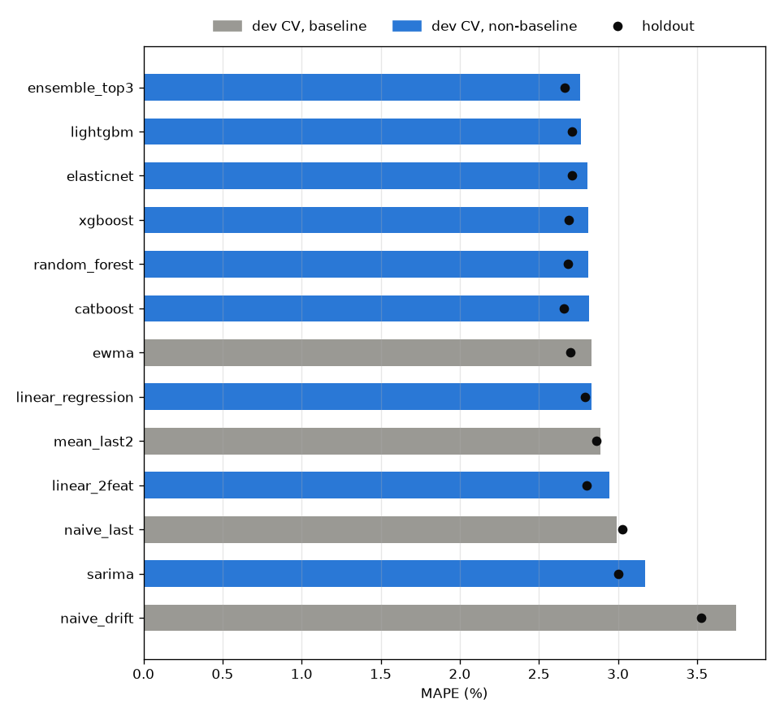
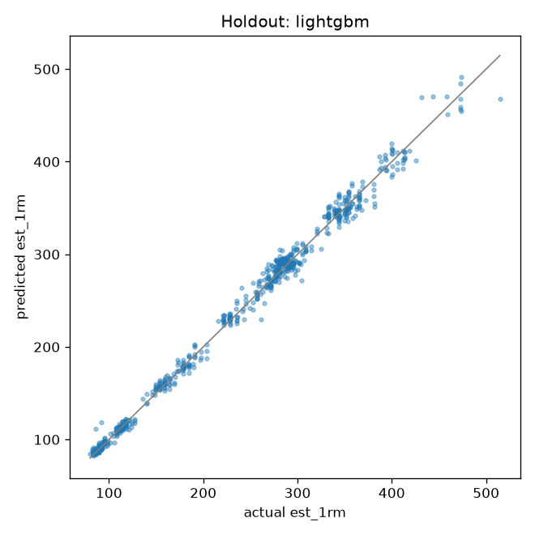
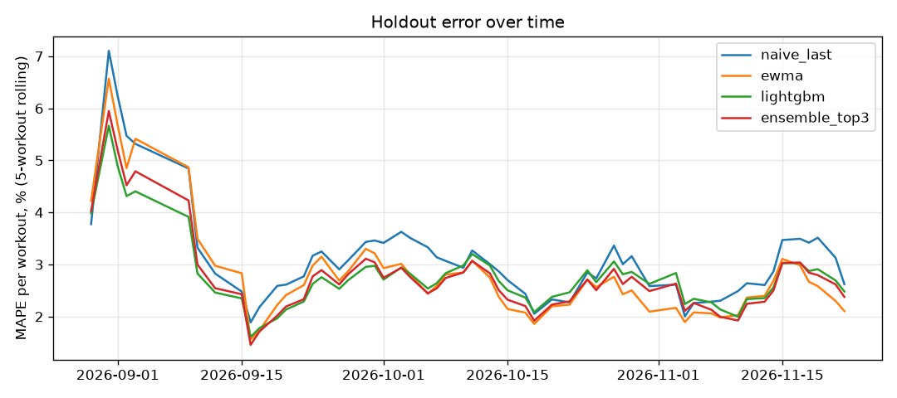

# Model selection

Run `20261123_205625`, generated 2026-11-23 21:28. Target: **est_1rm** of the next session of each exercise + set. Primary metric: **MAPE** (%); MAE and RMSE are in lb of e1RM.

## Outcome

**Production model: `lightgbm`** (default for inference; set by `PRODUCTION_MODEL` in `config.py`, not by the leaderboard).  
**Best overall by CV: `ensemble_top3`** (not a baseline).  
**Best non-baseline by CV: `ensemble_top3`**.

| role                             | model           |   CV MAPE % |   CV MAE |   CV RMSE |   holdout MAPE % |   holdout MAE |   holdout RMSE |
|:---------------------------------|:----------------|------------:|---------:|----------:|-----------------:|--------------:|---------------:|
| production                       | `lightgbm`      |        2.77 |     6.54 |      9.32 |             2.71 |          6.40 |           8.66 |
| best overall + best non-baseline | `ensemble_top3` |        2.76 |     6.55 |      9.36 |             2.66 |          6.27 |           8.59 |
| best baseline                    | `ewma`          |        2.83 |     6.70 |      9.60 |             2.70 |          6.23 |           8.71 |
| repeat last session              | `naive_last`    |        2.99 |     7.12 |     10.82 |             3.03 |          7.12 |          10.15 |

**Compared with the best baseline `ewma`** (negative = better than `ewma`; 95% CI from resampling whole workout dates):

- `lightgbm`, dev CV: MAPE -0.064 points [-0.167, +0.031], MAE -0.160 lb [-0.381, +0.052]: **within noise** (the interval includes zero).
- `lightgbm`, holdout: MAPE +0.006 points [-0.168, +0.160], MAE +0.170 lb [-0.181, +0.524]: **within noise** (the interval includes zero).
- `ensemble_top3`, dev CV: MAPE -0.072 points [-0.146, -0.001], MAE -0.158 lb [-0.325, +0.000]: **`ensemble_top3` is clearly better**.
- `ensemble_top3`, holdout: MAPE -0.037 points [-0.162, +0.075], MAE +0.042 lb [-0.224, +0.313]: **within noise** (the interval includes zero).

Winners are picked by dev-CV MAPE only. The holdout is a check, and it has already been viewed in earlier runs, so treat it as a sanity check more than a fresh test.



## Leaderboard

Sorted by dev-CV MAPE. MAPE and skill are primary; MAE and RMSE are in lb. `skill_vs_naive` is the holdout MAPE improvement over `naive_last`. `holdout_bias` is the mean over-prediction in lb. `target` is what the model was trained to predict (% or lb change from the last session or from the EWMA).

| model             | group    |   cv_mape |   cv_mape_std |   cv_mae |   cv_rmse |   holdout_mape |   holdout_mae |   holdout_rmse |   holdout_r2 |   holdout_bias |   skill_vs_naive | target      | n_features   | device   |
|:------------------|:---------|----------:|--------------:|---------:|----------:|---------------:|--------------:|---------------:|-------------:|---------------:|-----------------:|:------------|:-------------|:---------|
| ensemble_top3     | ensemble |     2.759 |         0.185 |    6.546 |     9.359 |          2.664 |         6.268 |          8.587 |        0.993 |          0.890 |            0.120 | —           | —            | cpu      |
| lightgbm          | trained  |     2.767 |         0.162 |    6.544 |     9.317 |          2.708 |         6.397 |          8.657 |        0.993 |          1.021 |            0.105 | pct vs last | 12           | cpu      |
| elasticnet        | trained  |     2.808 |         0.155 |    6.718 |     9.622 |          2.712 |         6.365 |          8.786 |        0.992 |          0.944 |            0.104 | pct vs ewma | 7            | cpu      |
| xgboost           | trained  |     2.810 |         0.266 |    6.625 |     9.494 |          2.687 |         6.302 |          8.689 |        0.993 |          0.705 |            0.112 | pct vs ewma | 12           | cpu      |
| random_forest     | trained  |     2.810 |         0.282 |    6.638 |     9.490 |          2.686 |         6.260 |          8.653 |        0.993 |          0.274 |            0.113 | pct vs ewma | 12           | cpu      |
| catboost          | trained  |     2.818 |         0.307 |    6.608 |     9.419 |          2.660 |         6.337 |          8.650 |        0.993 |          0.546 |            0.121 | pct vs ewma | 12           | cpu      |
| ewma              | baseline |     2.831 |         0.272 |    6.704 |     9.596 |          2.702 |         6.226 |          8.706 |        0.993 |          0.275 |            0.107 | —           | —            | cpu      |
| linear_regression | trained  |     2.835 |         0.159 |    6.763 |     9.623 |          2.793 |         6.553 |          8.972 |        0.992 |          0.835 |            0.077 | pct vs last | 7            | cpu      |
| mean_last2        | baseline |     2.888 |         0.331 |    6.865 |     9.991 |          2.863 |         6.635 |          9.223 |        0.992 |          0.273 |            0.054 | —           | —            | cpu      |
| linear_2feat      | simple   |     2.943 |         0.321 |    6.939 |    10.131 |          2.802 |         6.507 |          9.118 |        0.992 |          1.131 |            0.074 | —           | —            | cpu      |
| naive_last        | baseline |     2.992 |         0.282 |    7.121 |    10.817 |          3.027 |         7.120 |         10.150 |        0.990 |          0.198 |            0.000 | —           | —            | cpu      |
| sarima            | sarima   |     3.173 |         0.436 |    7.403 |    10.824 |          3.000 |         6.845 |          9.487 |        0.991 |          0.456 |            0.009 | —           | —            | cpu      |
| naive_drift       | baseline |     3.745 |         0.476 |    9.123 |    15.076 |          3.525 |         8.353 |         11.895 |        0.986 |          0.563 |           -0.165 | —           | —            | cpu      |

`ensemble_top3` = equal-weight mean of `lightgbm`, `elasticnet`, `xgboost`, the best non-baseline models by dev CV.

### Holdout difference from `naive_last`

Negative = better. 95% CIs; `p_better` = share of bootstrap samples with lower MAPE.

| model             |   mape_diff |   mape_diff_low |   mape_diff_high |   mae_diff |   mae_diff_low |   mae_diff_high |   p_better |
|:------------------|------------:|----------------:|-----------------:|-----------:|---------------:|----------------:|-----------:|
| catboost          |      -0.367 |          -0.594 |           -0.167 |     -0.783 |         -1.262 |          -0.337 |      1.000 |
| ensemble_top3     |      -0.362 |          -0.541 |           -0.188 |     -0.851 |         -1.272 |          -0.440 |      1.000 |
| random_forest     |      -0.341 |          -0.517 |           -0.152 |     -0.860 |         -1.279 |          -0.450 |      1.000 |
| xgboost           |      -0.340 |          -0.534 |           -0.150 |     -0.818 |         -1.260 |          -0.401 |      1.000 |
| ewma              |      -0.325 |          -0.502 |           -0.134 |     -0.893 |         -1.293 |          -0.521 |      0.999 |
| lightgbm          |      -0.319 |          -0.519 |           -0.124 |     -0.723 |         -1.209 |          -0.231 |      0.999 |
| elasticnet        |      -0.315 |          -0.477 |           -0.150 |     -0.754 |         -1.167 |          -0.363 |      1.000 |
| linear_regression |      -0.234 |          -0.417 |           -0.046 |     -0.566 |         -1.040 |          -0.105 |      0.989 |
| linear_2feat      |      -0.225 |          -0.332 |           -0.117 |     -0.613 |         -0.873 |          -0.362 |      1.000 |
| mean_last2        |      -0.163 |          -0.366 |            0.049 |     -0.485 |         -0.957 |          -0.051 |      0.935 |
| sarima            |      -0.027 |          -0.205 |            0.139 |     -0.275 |         -0.712 |           0.114 |      0.621 |
| naive_last        |       0.000 |           0.000 |            0.000 |      0.000 |          0.000 |           0.000 |      0.000 |
| naive_drift       |       0.499 |           0.379 |            0.618 |      1.233 |          0.889 |           1.590 |      0.000 |

## Forecast charts

est_1rm averaged over the sets in a session. Black = actual (dotted in the holdout). Every model point is a one-step-ahead prediction on data that model was not trained on: CV folds first, then the holdout. These are not multi-week forecasts.

Interactive versions (hover, click a model to hide it): `testing/artifacts/20261123_205625/charts/`.

**By exercise:** [Ab Crunch](figures/charts/by_exercise/Ab_Crunch.png), [Barbell Shoulder Press](figures/charts/by_exercise/Barbell_Shoulder_Press.png), [Bayesian Curl](figures/charts/by_exercise/Bayesian_Curl.png), [Bench Press](figures/charts/by_exercise/Bench_Press.png), [Cable Curl](figures/charts/by_exercise/Cable_Curl.png), [Cable Fly](figures/charts/by_exercise/Cable_Fly.png), [Calf Raise](figures/charts/by_exercise/Calf_Raise.png), [Hamstring Curl](figures/charts/by_exercise/Hamstring_Curl.png), [Hip Abductor](figures/charts/by_exercise/Hip_Abductor.png), [Hip Adductor](figures/charts/by_exercise/Hip_Adductor.png), [JM Press](figures/charts/by_exercise/JM_Press.png), [JPG Row](figures/charts/by_exercise/JPG_Row.png), [Lat Pulldown](figures/charts/by_exercise/Lat_Pulldown.png), [Leg Press](figures/charts/by_exercise/Leg_Press.png), [Machine Curl](figures/charts/by_exercise/Machine_Curl.png), [Machine Lateral Raises](figures/charts/by_exercise/Machine_Lateral_Raises.png), [Quad Extension](figures/charts/by_exercise/Quad_Extension.png), [Reverse Fly](figures/charts/by_exercise/Reverse_Fly.png), [Single Arm Tricep Pushdown](figures/charts/by_exercise/Single_Arm_Tricep_Pushdown.png), [Smith Incline Bench](figures/charts/by_exercise/Smith_Incline_Bench.png), [Smith Squat](figures/charts/by_exercise/Smith_Squat.png), [Squat](figures/charts/by_exercise/Squat.png), [T-Bar Row](figures/charts/by_exercise/T_Bar_Row.png), [Tricep Pushdown](figures/charts/by_exercise/Tricep_Pushdown.png)

No out-of-sample predictions, so no chart: Cable Lateral Raises, Deadlift, Dumbell Curl, Dumbell Shoulder Press, Laying Face Pulls, Preacher Curl, RDL, Shrugs, Tricep Overhead Extension.

## Data and splits

- Feature table: **4081** set rows. Dropped **75** with no previous session for that exercise + set (nothing to predict from) and **0** with no target.
- **Dev:** 3356 rows, 317 workouts (2025-04-12 to 2026-08-27).
- **Holdout:** 650 rows, 56 workouts (2026-08-29 to 2026-11-22), the last 15% of workout dates. Never used for feature selection or tuning.
- **Walk-forward CV on dev:** 5 expanding-window folds, split by workout date.

|   fold | train_start   | train_end   | val_start   | val_end    |   train_rows |   val_rows |   val_workouts |
|-------:|:--------------|:------------|:------------|:-----------|-------------:|-----------:|---------------:|
|      1 | 2025-04-12    | 2026-01-27  | 2026-01-28  | 2026-03-10 |         1971 |        288 |             26 |
|      2 | 2025-04-12    | 2026-03-10  | 2026-03-11  | 2026-04-14 |         2259 |        277 |             26 |
|      3 | 2025-04-12    | 2026-04-14  | 2026-04-15  | 2026-06-03 |         2536 |        274 |             25 |
|      4 | 2025-04-12    | 2026-06-03  | 2026-06-04  | 2026-07-18 |         2810 |        282 |             25 |
|      5 | 2025-04-12    | 2026-07-18  | 2026-07-19  | 2026-08-27 |         3092 |        264 |             25 |

## Per-fold CV MAPE (%)

| model             |     1 |     2 |     3 |     4 |     5 |   mean |
|:------------------|------:|------:|------:|------:|------:|-------:|
| ensemble_top3     | 2.799 | 2.789 | 3.032 | 2.615 | 2.562 |  2.759 |
| lightgbm          | 2.806 | 2.823 | 2.989 | 2.634 | 2.584 |  2.767 |
| elasticnet        | 2.864 | 2.819 | 3.028 | 2.707 | 2.622 |  2.808 |
| xgboost           | 2.809 | 2.831 | 3.237 | 2.606 | 2.566 |  2.810 |
| random_forest     | 2.862 | 2.810 | 3.251 | 2.588 | 2.541 |  2.810 |
| catboost          | 2.820 | 2.789 | 3.326 | 2.602 | 2.551 |  2.818 |
| ewma              | 2.909 | 2.782 | 3.258 | 2.617 | 2.588 |  2.831 |
| linear_regression | 2.905 | 2.809 | 3.068 | 2.740 | 2.655 |  2.835 |
| mean_last2        | 2.897 | 2.817 | 3.437 | 2.721 | 2.568 |  2.888 |
| linear_2feat      | 2.927 | 2.937 | 3.473 | 2.732 | 2.648 |  2.943 |
| naive_last        | 3.021 | 3.118 | 3.381 | 2.709 | 2.729 |  2.992 |
| sarima            | 3.171 | 3.077 | 3.907 | 2.927 | 2.785 |  3.173 |
| naive_drift       | 3.690 | 3.559 | 4.570 | 3.541 | 3.363 |  3.745 |

## Holdout MAPE (%) by exercise

| exercise               |     n |   lightgbm |   ewma |   ensemble_top3 |   naive_last |   elasticnet |   xgboost |   random_forest |   catboost |   linear_regression |   mean_last2 |   linear_2feat |   sarima |   naive_drift |
|:-----------------------|------:|-----------:|-------:|----------------:|-------------:|-------------:|----------:|----------------:|-----------:|--------------------:|-------------:|---------------:|---------:|--------------:|
| Bench Press            | 94.00 |       2.90 |   2.73 |            2.79 |         3.28 |         2.93 |      2.61 |            2.61 |       2.82 |                3.13 |         3.06 |           2.85 |     3.28 |          3.54 |
| Tricep Pushdown        | 63.00 |       2.74 |   3.05 |            2.81 |         3.34 |         2.91 |      2.97 |            2.96 |       2.62 |                2.99 |         3.31 |           3.12 |     3.43 |          3.59 |
| Machine Lateral Raises | 48.00 |       2.67 |   2.38 |            2.52 |         2.77 |         2.53 |      2.42 |            2.42 |       2.50 |                2.61 |         2.48 |           2.75 |     3.31 |          3.14 |
| Quad Extension         | 44.00 |       2.27 |   2.22 |            2.25 |         2.56 |         2.26 |      2.26 |            2.27 |       2.22 |                2.22 |         2.34 |           2.29 |     2.37 |          2.84 |
| Cable Curl             | 42.00 |       2.45 |   2.42 |            2.50 |         2.78 |         2.57 |      2.52 |            2.55 |       2.53 |                2.53 |         2.47 |           2.69 |     2.63 |          3.21 |
| T-Bar Row              | 40.00 |       2.76 |   2.92 |            2.71 |         3.65 |         2.72 |      2.69 |            2.78 |       2.79 |                2.89 |         2.95 |           3.18 |     3.61 |          4.64 |
| Lat Pulldown           | 40.00 |       1.91 |   1.68 |            1.71 |         1.80 |         1.59 |      1.82 |            1.75 |       1.89 |                1.61 |         1.85 |           1.69 |     1.64 |          2.31 |
| Hamstring Curl         | 38.00 |       2.01 |   2.09 |            2.07 |         2.61 |         2.12 |      2.15 |            2.07 |       2.14 |                2.04 |         2.14 |           2.27 |     1.96 |          2.84 |
| Ab Crunch              | 38.00 |       4.67 |   5.43 |            4.71 |         4.99 |         4.82 |      4.91 |            5.22 |       4.25 |                5.07 |         5.58 |           4.87 |     5.34 |          5.67 |
| Calf Raise             | 36.00 |       2.67 |   2.45 |            2.59 |         2.64 |         2.48 |      2.66 |            2.62 |       2.77 |                2.54 |         2.45 |           2.56 |     2.50 |          3.18 |
| Squat                  | 33.00 |       2.48 |   1.99 |            2.26 |         2.17 |         2.28 |      2.23 |            2.32 |       2.33 |                2.29 |         2.27 |           2.05 |     1.86 |          2.81 |
| Smith Squat            | 24.00 |       1.81 |   2.00 |            1.99 |         2.49 |         2.06 |      2.52 |            1.87 |       1.93 |                2.51 |         1.97 |           2.28 |     2.49 |          3.34 |
| Reverse Fly            | 23.00 |       3.55 |   3.37 |            3.49 |         3.38 |         3.64 |      3.36 |            3.57 |       3.56 |                3.61 |         3.78 |           3.20 |     3.35 |          4.48 |
| Barbell Shoulder Press | 22.00 |       2.04 |   2.39 |            1.90 |         2.48 |         1.89 |      1.93 |            1.91 |       2.04 |                1.88 |         2.49 |           2.29 |     3.78 |          3.33 |
| JPG Row                | 19.00 |       2.46 |   2.21 |            2.51 |         2.59 |         2.79 |      2.28 |            2.33 |       2.34 |                2.96 |         2.14 |           2.58 |     2.44 |          3.52 |
| Smith Incline Bench    | 15.00 |       2.93 |   2.75 |            2.84 |         3.49 |         2.89 |      2.92 |            3.01 |       3.16 |                2.74 |         2.77 |           3.11 |     3.14 |          3.45 |
| Hip Abductor           | 14.00 |       3.34 |   3.66 |            3.62 |         4.20 |         3.94 |      3.59 |            3.61 |       3.44 |                3.86 |         4.01 |           3.79 |     3.44 |          4.46 |
| Hip Adductor           | 11.00 |       4.18 |   3.81 |            4.01 |         4.39 |         3.85 |      3.99 |            4.07 |       4.17 |                3.76 |         4.35 |           3.96 |     3.58 |          5.83 |
| Machine Curl           |  6.00 |       1.94 |   2.50 |            1.64 |         2.08 |         1.13 |      2.22 |            1.34 |       1.65 |                1.48 |         2.60 |           2.31 |     2.08 |          2.05 |

## Holdout MAE (lb) by exercise

| exercise               |     n |   lightgbm |   ewma |   ensemble_top3 |   naive_last |   elasticnet |   xgboost |   random_forest |   catboost |   linear_regression |   mean_last2 |   linear_2feat |   sarima |   naive_drift |
|:-----------------------|------:|-----------:|-------:|----------------:|-------------:|-------------:|----------:|----------------:|-----------:|--------------------:|-------------:|---------------:|---------:|--------------:|
| Bench Press            | 94.00 |       8.25 |   7.80 |            7.93 |         9.34 |         8.29 |      7.45 |            7.44 |       8.00 |                8.84 |         8.73 |           8.11 |     9.34 |         10.05 |
| Tricep Pushdown        | 63.00 |       3.18 |   3.52 |            3.25 |         3.87 |         3.37 |      3.41 |            3.41 |       3.03 |                3.48 |         3.81 |           3.60 |     3.93 |          4.15 |
| Machine Lateral Raises | 48.00 |       4.13 |   3.70 |            3.90 |         4.32 |         3.93 |      3.75 |            3.74 |       3.86 |                4.04 |         3.86 |           4.27 |     5.18 |          4.89 |
| Quad Extension         | 44.00 |       7.91 |   7.74 |            7.81 |         8.89 |         7.86 |      7.86 |            7.90 |       7.72 |                7.72 |         8.15 |           7.97 |     8.25 |          9.83 |
| Cable Curl             | 42.00 |       2.10 |   2.09 |            2.15 |         2.40 |         2.21 |      2.17 |            2.19 |       2.18 |                2.18 |         2.14 |           2.30 |     2.28 |          2.77 |
| T-Bar Row              | 40.00 |       6.40 |   6.78 |            6.30 |         8.49 |         6.31 |      6.26 |            6.45 |       6.46 |                6.69 |         6.84 |           7.36 |     8.41 |         10.68 |
| Lat Pulldown           | 40.00 |       5.11 |   4.49 |            4.59 |         4.82 |         4.24 |      4.87 |            4.69 |       5.06 |                4.31 |         4.96 |           4.52 |     4.38 |          6.19 |
| Hamstring Curl         | 38.00 |       5.96 |   6.24 |            6.16 |         7.79 |         6.32 |      6.39 |            6.16 |       6.37 |                6.11 |         6.39 |           6.78 |     5.82 |          8.48 |
| Ab Crunch              | 38.00 |       4.33 |   5.00 |            4.35 |         4.64 |         4.45 |      4.52 |            4.80 |       3.95 |                4.67 |         5.13 |           4.51 |     4.95 |          5.27 |
| Calf Raise             | 36.00 |       9.40 |   8.64 |            9.15 |         9.37 |         8.77 |      9.38 |            9.24 |       9.80 |                8.95 |         8.64 |           9.04 |     8.84 |         11.30 |
| Squat                  | 33.00 |       9.99 |   8.03 |            9.11 |         8.75 |         9.14 |      9.01 |            9.40 |       9.39 |                9.22 |         9.16 |           8.26 |     7.54 |         11.29 |
| Smith Squat            | 24.00 |       6.27 |   6.94 |            6.87 |         8.62 |         7.12 |      8.66 |            6.49 |       6.68 |                8.80 |         6.84 |           7.89 |     8.62 |         11.55 |
| Reverse Fly            | 23.00 |       6.71 |   6.40 |            6.61 |         6.36 |         6.90 |      6.36 |            6.79 |       6.74 |                6.82 |         7.16 |           6.00 |     6.38 |          8.41 |
| Barbell Shoulder Press | 22.00 |       3.68 |   4.29 |            3.43 |         4.45 |         3.39 |      3.48 |            3.45 |       3.66 |                3.40 |         4.48 |           4.09 |     6.84 |          5.96 |
| JPG Row                | 19.00 |       7.10 |   6.42 |            7.27 |         7.52 |         8.10 |      6.61 |            6.78 |       6.77 |                8.56 |         6.20 |           7.47 |     7.06 |         10.20 |
| Smith Incline Bench    | 15.00 |       7.29 |   6.81 |            7.04 |         8.73 |         7.18 |      7.23 |            7.48 |       7.86 |                6.78 |         6.87 |           7.71 |     7.78 |          8.66 |
| Hip Abductor           | 14.00 |      11.83 |  12.91 |           12.83 |        14.75 |        13.93 |     12.73 |           12.78 |      12.19 |               13.69 |        14.16 |          13.35 |    12.10 |         15.63 |
| Hip Adductor           | 11.00 |      19.56 |  17.83 |           18.78 |        20.43 |        18.05 |     18.72 |           19.09 |      19.53 |               17.68 |        20.35 |          18.44 |    16.74 |         27.14 |
| Machine Curl           |  6.00 |       3.07 |   3.95 |            2.58 |         3.28 |         1.80 |      3.45 |            2.13 |       2.60 |                2.32 |         4.10 |           3.62 |     3.28 |          3.23 |





## SARIMA

- 58 of 74 exercise + set series had at least 20 sessions and got a SARIMA. Rows from the other series fall back to `naive_last`.
- Holdout rows covered by a fitted SARIMA: **78%**.
- Orders chosen by AIC (final model):

| order                    |   series |
|:-------------------------|---------:|
| (0, 1, 1)                |       20 |
| (1, 1, 0)                |        7 |
| (1, 1, 1)                |        7 |
| (0, 1, 0)                |        5 |
| (0, 1, 1) x (1, 0, 0, 4) |        5 |
| (0, 1, 1) x (0, 0, 1, 4) |        4 |
| (1, 1, 2)                |        3 |
| (0, 1, 2)                |        2 |
| (1, 1, 0) x (0, 0, 1, 4) |        1 |
| (0, 1, 0) x (0, 0, 1, 4) |        1 |
| (2, 1, 0) x (1, 0, 0, 4) |        1 |
| (2, 1, 0)                |        1 |
| (2, 1, 2)                |        1 |

## GPU vs CPU

| library   | gpu_available   | note                                                           |   cpu_fit_s |   gpu_fit_s | chosen   |
|:----------|:----------------|:---------------------------------------------------------------|------------:|------------:|:---------|
| lightgbm  | False           | LightGBMError: GPU Tree Learner was not enabled in this build. |     nan     |     nan     | cpu      |
| xgboost   | False           | silently fell back to cpu (cause not determined)               |     nan     |     nan     | cpu      |
| catboost  | True            | CUDA; fits/s CPU x4 parallel = 0.29, GPU = 0.13                |      13.946 |       7.539 | cpu      |

In `auto` mode each library uses whichever gives more fits per second. CPU runs 4 Optuna trials in parallel; GPU trials run one at a time.

## Tuning

| model             |   trials | states                         |   tune_seconds | device   |   parallel_trials |   threads_per_fit |
|:------------------|---------:|:-------------------------------|---------------:|:---------|------------------:|------------------:|
| ewma              |        3 | {'COMPLETE': 3}                |          1.200 | cpu      |                 4 |                 4 |
| linear_regression |        6 | {'COMPLETE': 6}                |          2.500 | cpu      |                 4 |                 4 |
| elasticnet        |       50 | {'COMPLETE': 43, 'PRUNED': 7}  |         25.500 | cpu      |                 4 |                 4 |
| random_forest     |       50 | {'COMPLETE': 38, 'PRUNED': 12} |         99.800 | cpu      |                 4 |                 4 |
| lightgbm          |      100 | {'COMPLETE': 54, 'PRUNED': 46} |         91.500 | cpu      |                 4 |                 4 |
| xgboost           |      100 | {'COMPLETE': 93, 'PRUNED': 7}  |        128.800 | cpu      |                 4 |                 4 |
| catboost          |       60 | {'COMPLETE': 44, 'PRUNED': 16} |       1190.800 | cpu      |                 4 |                 4 |

## Best hyperparameters

**ewma**

```json
{
  "alpha_pct": 50
}
```

**linear_regression**

```json
{
  "target_mode": "pct",
  "base": "est_1rm_most_recent"
}
```

**elasticnet**

```json
{
  "target_mode": "pct",
  "base": "est_1rm_ewma_50",
  "alpha": 0.0002518408436722592,
  "l1_ratio": 0.7230332645081006
}
```

**random_forest**

```json
{
  "target_mode": "pct",
  "base": "est_1rm_ewma_50",
  "n_estimators": 319,
  "max_depth": null,
  "min_samples_leaf": 19,
  "max_features": 0.2476591479736352
}
```

**lightgbm**

```json
{
  "target_mode": "pct",
  "base": "est_1rm_most_recent",
  "n_estimators": 157,
  "learning_rate": 0.03738631853965681,
  "num_leaves": 10,
  "min_child_samples": 6,
  "colsample_bytree": 0.690024957282678,
  "subsample": 0.5716337040280332,
  "subsample_freq": 1,
  "reg_alpha": 0.10492200806238246,
  "reg_lambda": 0.710389010191965
}
```

**xgboost**

```json
{
  "target_mode": "pct",
  "base": "est_1rm_ewma_50",
  "n_estimators": 99,
  "learning_rate": 0.02135999322382508,
  "max_depth": 8,
  "min_child_weight": 2.125962076575893,
  "subsample": 0.9175966034933042,
  "colsample_bytree": 0.6921239738179183,
  "reg_alpha": 0.3550565486918481,
  "reg_lambda": 0.07443118710745038
}
```

**catboost**

```json
{
  "target_mode": "pct",
  "base": "est_1rm_ewma_50",
  "iterations": 456,
  "depth": 6,
  "learning_rate": 0.025372529727373857,
  "l2_leaf_reg": 5.419534845412138
}
```


## Artifacts

Saved in `testing/artifacts/20261123_205625/models/`: one `<model>.joblib` per model type, refit on dev + holdout (all data), plus a `<model>.json` with parameters, features and metrics.

```python
from modeling.inference import load_model, predict_next, e1rm_to_weight
model, meta = load_model()                      # production: lightgbm
model, meta = load_model('best')                # best CV MAPE: ensemble_top3
model, meta = load_model('ewma')                # any model by name
```

## Caveats

- All scores are one step ahead: each prediction uses every session before that workout.
- Feature selection, tuning, the EWMA alpha and the ensemble members all used the same dev folds, so CV scores are slightly optimistic, more so for models with more tuning.
- Many models are compared, so small gaps between them are expected by chance.